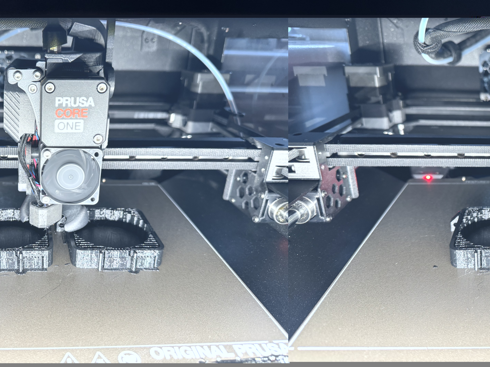
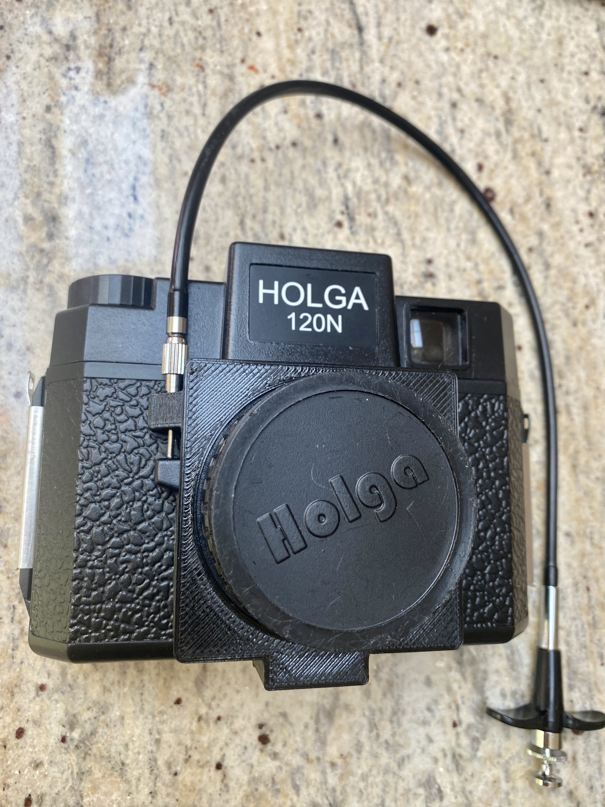

## Manufacturing
All parts are made on my [Prusa CORE One+ (Gen 2)](https://www.prusa3d.com/product/prusa-core-one-kit/), which I built myself from a kit, using PETG filament.

They are all hand finished and are tested using my cameras for fit and function.

